<h1 align="center">
   TradingWorks+
</h1>

<p align="center">
  Marca o ponto, acompanha jornada e banco de horas, e te avisa na hora certa — sem precisar ficar com a aba do TradingWorks aberta o dia todo.
</p>

<div align="center">

  [](https://github.com/ErnaneJ/tradingworks-plus/releases)
  [](./LICENSE.md)
  [](./src/manifest.json)
  [](https://svelte.dev)

</div>

<p align="center">
  <a href="./docs/en/README.md">English</a> ·
  <a href="./docs/es/README.md">Español</a>
</p>

<p align="center">
  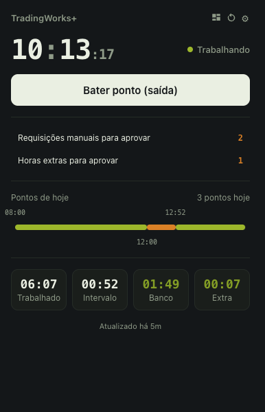
</p>

## Índice

- [O que é](#o-que-é)
- [Funcionalidades](#funcionalidades)
- [Popup: 11 formatos](#popup-11-formatos)
- [Painel de opções](#painel-de-opções)
- [Tecnologias](#tecnologias)
- [Instalação](#instalação)
- [Privacidade](#privacidade)
- [Desenvolvendo](#desenvolvendo)
- [Apoie o projeto](#apoie-o-projeto)

## O que é

TradingWorks+ é uma extensão de navegador, não oficial e sem qualquer vínculo com a empresa TWO, que torna o uso do [TradingWorks](https://app.tradingworks.net/) mais rápido no dia a dia. Em vez de entrar na plataforma e navegar por várias telas, você bate o ponto, acompanha o saldo do dia e recebe avisos direto do navegador.

<p align="center">
  <b>Esta extensão apenas reorganiza, de forma mais prática, dados que a própria plataforma TradingWorks já disponibiliza ao colaborador.</b>
</p>

## Funcionalidades

- **Ponto em um clique**, com o status atual (trabalhando, em intervalo, jornada concluída);
- **Linha do tempo do dia**, mostrando entradas, intervalos e horas extras lado a lado;
- **Banco de horas**, com saldo atual e histórico mês a mês;
- **Histórico de apontamentos**, com os registros de dias anteriores;
- **Painel da equipe**, para quem precisa acompanhar ou aprovar apontamentos de outras pessoas;
- **Notificações configuráveis** por evento (entrada, saída, fim de intervalo, jornada perto de terminar, horas extras, etc.), entregues por notificação do navegador, webhook genérico ou Discord;
- **11 formatos de popup** diferentes, para escolher o que mostra só o essencial ou o painel completo;
- **Tema claro, escuro ou automático**, seguindo o sistema;
- Interface em **português (padrão), inglês e espanhol**.

_Obs.: as informações são lidas diretamente da sessão já autenticada do TradingWorks no seu navegador — a extensão não pede login nem senha, só reaproveita a sessão que você já tem aberta._

## Popup: 11 formatos

Clique no ícone no cabeçalho do popup pra alternar entre os formatos, do mais enxuto ao mais completo. Alguns exemplos:

<table>
  <tr>
    <td align="center">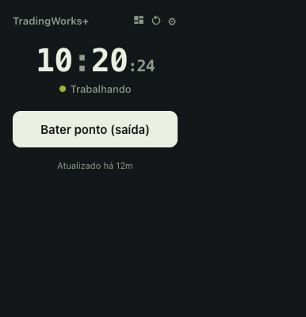<br><sub>Minimal</sub></td>
    <td align="center">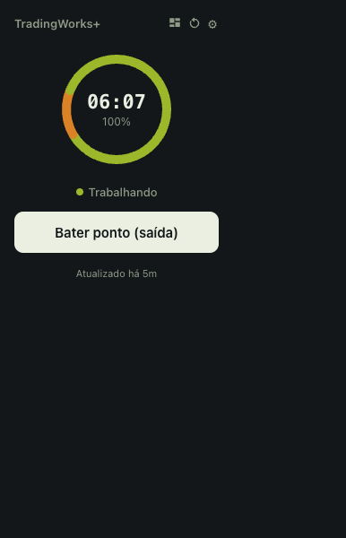<br><sub>Ring</sub></td>
    <td align="center">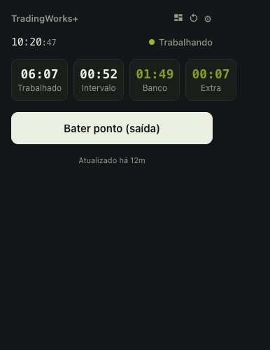<br><sub>Stats</sub></td>
  </tr>
  <tr>
    <td align="center">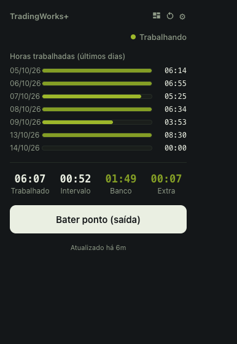<br><sub>Week</sub></td>
    <td align="center">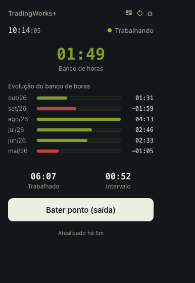<br><sub>Time bank</sub></td>
    <td align="center"><br><sub>Full</sub></td>
  </tr>
</table>

Os outros cinco (standard, compact, timeline, classic e approvals) ficam disponíveis no mesmo ciclo, direto no popup.

## Painel de opções

<table>
  <tr>
    <td align="center">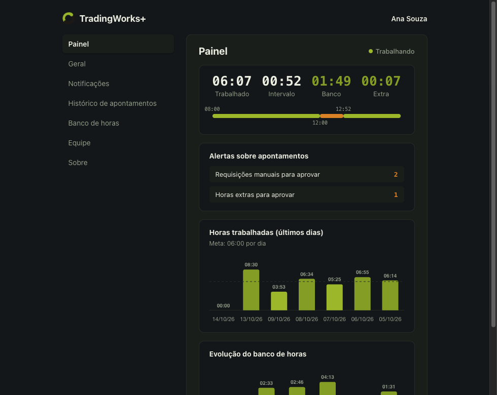<br><sub>Painel</sub></td>
    <td align="center">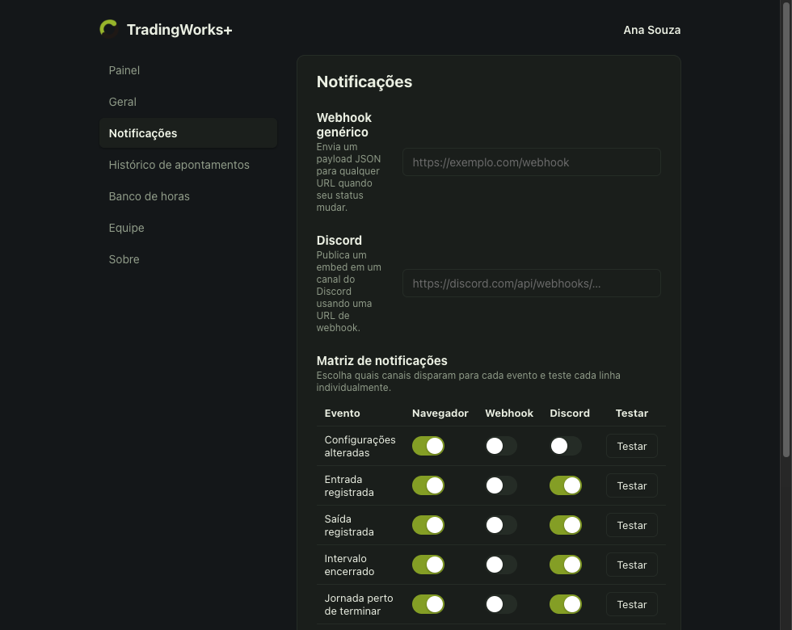<br><sub>Notificações</sub></td>
  </tr>
  <tr>
    <td align="center">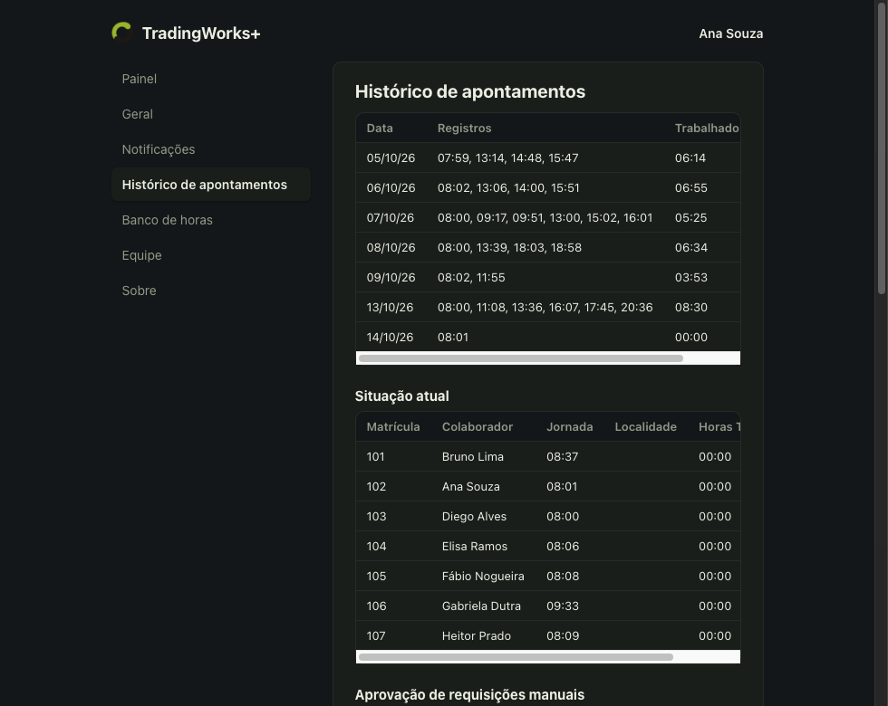<br><sub>Histórico de apontamentos</sub></td>
    <td align="center">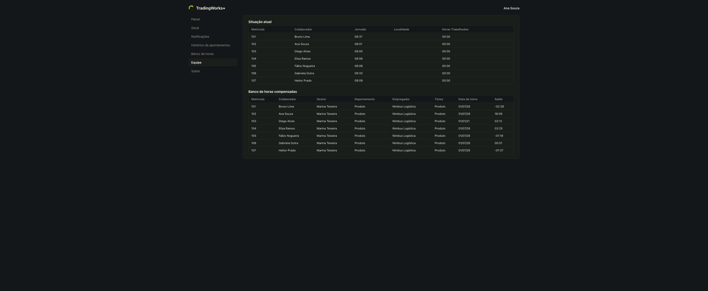<br><sub>Equipe</sub></td>
  </tr>
</table>

> As imagens acima usam dados fictícios de demonstração — nenhuma é captura real de empresa ou colaborador algum.

## Tecnologias

- [Svelte 4](https://svelte.dev) + [TypeScript](https://www.typescriptlang.org/) + [Vite 5](https://vitejs.dev)
- Chrome Extension **Manifest V3** (service worker, `chrome.alarms`, `chrome.storage`, `chrome.notifications`)
- [Vitest](https://vitest.dev) para os testes

## Instalação

### Pela loja do Chrome (recomendado)

[Instalar o TradingWorks+ na Chrome Web Store](https://chromewebstore.google.com/detail/tradingworks+/gekmgdfmjoccmkagkbcboidgknlolihl)

### Manualmente, a partir do código-fonte

Use este caminho se quiser testar uma branch específica ou contribuir com o projeto.

```bash
git clone git@github.com:ErnaneJ/tradingworks-plus.git
cd tradingworks-plus
npm install
npm run build
```

Depois:

1. Abra `chrome://extensions` no navegador;

  <p align="center">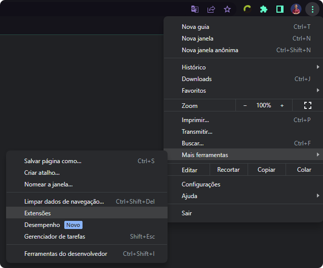</p>

2. Ative o **Modo do desenvolvedor**;

  <p align="center">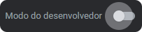</p>

3. Clique em **Carregar sem compactação** e selecione a pasta `dist/` gerada pelo build;

  <p align="center">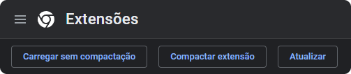</p>

4. Pronto — o ícone do TradingWorks+ aparece na barra de extensões.

  <p align="center">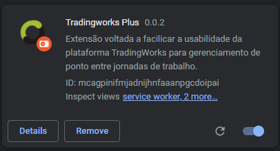</p>

## Privacidade

A extensão não envia os dados do seu ponto para nenhum servidor próprio: tudo fica salvo localmente no navegador (`chrome.storage.local`), e só sai do seu dispositivo se você mesmo configurar um webhook ou integração com Discord nas Notificações. Detalhes completos na [Política de Privacidade](./docs/privacy_policy/pt-BR.md).

## Desenvolvendo

Encontrou um problema ou quer sugerir algo? Abra uma [issue](https://github.com/ErnaneJ/tradingworks-plus/issues/new). Quer contribuir com código?

```bash
npm run dev       # build em modo watch
npm run typecheck # TypeScript + svelte-check
npm run test      # Vitest
```

Carregue a pasta `dist/` como extensão sem compactação (passo 3 da instalação manual) pra ver suas mudanças em ação. Quando terminar, abra um PR — toda contribuição é bem-vinda.

## Apoie o projeto

Qualquer crítica construtiva é bem-vinda. Se o TradingWorks+ te poupa tempo no dia a dia, considere apoiar o projeto:

<p align="center">
  <a href="https://github.com/sponsors/ErnaneJ">
    
  </a>
</p>

---

<div align="center">
  2023–2026 · <b>TradingWorks+</b> · <a href="https://github.com/ErnaneJ/tradingworks-plus/blob/main/LICENSE.md">MIT</a>
</div>
