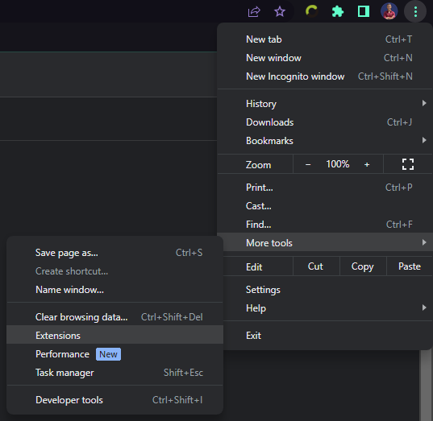
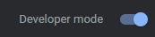
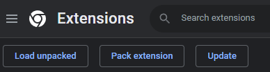

<h1 align="center">
   TradingWorks+
</h1>

<p align="center">
  Clock in, track your workday and time bank, and get notified at the right moment — without keeping a TradingWorks tab open all day.
</p>

<div align="center">

  [](https://github.com/ErnaneJ/tradingworks-plus/releases)
  [](../../LICENSE.md)
  [](../../src/manifest.json)
  [](https://svelte.dev)

</div>

<p align="center">
  <a href="../../README.md">Português (Brasil)</a> ·
  <a href="../es/README.md">Español</a>
</p>

<p align="center">
  
</p>

## Contents

- [What it is](#what-it-is)
- [Features](#features)
- [Popup: 11 layouts](#popup-11-layouts)
- [Options panel](#options-panel)
- [Technologies](#technologies)
- [Installation](#installation)
- [Privacy](#privacy)
- [Developing](#developing)
- [Support the project](#support-the-project)

## What it is

TradingWorks+ is an unofficial browser extension, with no affiliation to the TWO company, that makes day-to-day use of [TradingWorks](https://app.tradingworks.net/) faster. Instead of logging into the platform and clicking through several screens, you clock in, check today's balance, and get notified straight from the browser.

<p align="center">
  <b>This extension only reorganizes, in a more convenient way, data the TradingWorks platform already exposes to the employee.</b>
</p>

## Features

- **One-click clock in/out**, with live status (working, on break, shift finished);
- **Day timeline**, showing clock-ins, breaks and overtime side by side;
- **Time bank**, with current balance and month-by-month history;
- **Attendance history**, with previous days' records;
- **Team panel**, for anyone who needs to review or approve other people's attendance;
- **Configurable notifications** per event (clock-in, clock-out, break ending, shift ending soon, overtime threshold, etc.), delivered via browser notification, generic webhook or Discord;
- **11 popup layouts**, from a minimal glance to the full dashboard;
- **Light, dark or system theme**;
- Interface in **Portuguese (default), English and Spanish**.

_Note: data is read directly from your already-authenticated TradingWorks browser session — the extension never asks for a login or password, it just reuses the session you already have open._

## Popup: 11 layouts

Click the layout icon in the popup header to cycle through them, from the leanest to the most complete. A few examples:

<table>
  <tr>
    <td align="center"><br><sub>Minimal</sub></td>
    <td align="center"><br><sub>Ring</sub></td>
    <td align="center"><br><sub>Stats</sub></td>
  </tr>
  <tr>
    <td align="center"><br><sub>Week</sub></td>
    <td align="center"><br><sub>Time bank</sub></td>
    <td align="center"><br><sub>Full</sub></td>
  </tr>
</table>

The other five (standard, compact, timeline, classic and approvals) are part of the same cycle, right in the popup.

## Options panel

<table>
  <tr>
    <td align="center"><br><sub>Dashboard</sub></td>
    <td align="center"><br><sub>Notifications</sub></td>
  </tr>
  <tr>
    <td align="center"><br><sub>Attendance history</sub></td>
    <td align="center"><br><sub>Team</sub></td>
  </tr>
</table>

> The screenshots above use fictitious demo data — none of them are real captures of any company or employee.

## Technologies

- [Svelte 4](https://svelte.dev) + [TypeScript](https://www.typescriptlang.org/) + [Vite 5](https://vitejs.dev)
- Chrome Extension **Manifest V3** (service worker, `chrome.alarms`, `chrome.storage`, `chrome.notifications`)
- [Vitest](https://vitest.dev) for tests

## Installation

### From the Chrome Web Store (recommended)

[Install TradingWorks+ from the Chrome Web Store](https://chromewebstore.google.com/detail/tradingworks+/gekmgdfmjoccmkagkbcboidgknlolihl)

### Manually, from source

Use this path if you want to try a specific branch or contribute to the project.

```bash
git clone git@github.com:ErnaneJ/tradingworks-plus.git
cd tradingworks-plus
npm install
npm run build
```

Then:

1. Open `chrome://extensions`;

  <p align="center"></p>

2. Enable **Developer mode**;

  <p align="center"></p>

3. Click **Load unpacked** and select the `dist/` folder produced by the build;

  <p align="center"></p>

4. Done — the TradingWorks+ icon shows up in the extensions toolbar.

  <p align="center"></p>

## Privacy

The extension doesn't send your clock-in data to any server of its own: everything stays stored locally in the browser (`chrome.storage.local`), and only leaves your device if you set up a webhook or Discord integration yourself in Notifications. Full details in the [Privacy Policy](../privacy_policy/en.md).

## Developing

Found a problem or want to suggest something? Open an [issue](https://github.com/ErnaneJ/tradingworks-plus/issues/new). Want to contribute code?

```bash
npm run dev       # watch-mode build
npm run typecheck # TypeScript + svelte-check
npm run test      # Vitest
```

Load the `dist/` folder as an unpacked extension (step 3 of the manual install) to see your changes live. When you're done, open a PR — every contribution is welcome.

## Support the project

Any constructive criticism is welcome. If TradingWorks+ saves you time day to day, consider supporting the project:

<p align="center">
  <a href="https://github.com/sponsors/ErnaneJ">
    
  </a>
</p>

---

<div align="center">
  2023–2026 · <b>TradingWorks+</b> · <a href="https://github.com/ErnaneJ/tradingworks-plus/blob/main/LICENSE.md">MIT</a>
</div>
