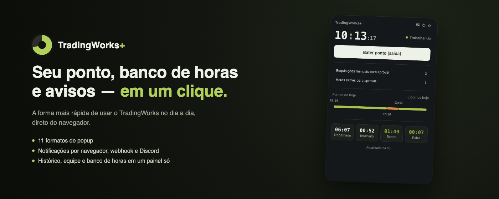

<p align="center">
  <a href="../video/promo.mp4">
    
  </a>
</p>

<h1 align="center">
   TradingWorks+
</h1>

<p align="center">
  Marca tu entrada y salida, controla tu jornada y tu bolsa de horas, y recibe avisos en el momento justo — sin tener que dejar TradingWorks abierto todo el día.
</p>

<div align="center">

  [](https://github.com/ErnaneJ/tradingworks-plus/releases)
  [](../../LICENSE.md)
  [](../../src/manifest.json)
  [](https://svelte.dev)

</div>

<p align="center">
  <a href="../../README.md">Português (Brasil)</a> ·
  <a href="../en/README.md">English</a>
</p>

## Qué es

TradingWorks+ es una extensión de navegador sin vínculo oficial con la empresa TWO. La idea es simple: dejar de entrar a [TradingWorks](https://app.tradingworks.net/) solo para ver si marcaste la entrada o cuánta bolsa de horas tienes. La extensión lo resuelve en un clic, directo desde el navegador — sin reinventar nada, solo reorganizando lo que la propia plataforma ya muestra.

## Funcionalidades

Marca tu entrada con un clic y ve al instante si estás trabajando, en descanso o si ya terminaste la jornada. La línea de tiempo del día muestra entradas, descansos y horas extra lado a lado, y tu bolsa de horas siempre está a la mano, con el saldo actual y el historial mes a mes. Puedes revisar el historial de marcaciones cuando necesites consultar un día anterior, y quien aprueba la marcación del equipo puede revisar y aprobar directo desde el panel.

También puedes elegir cómo quieres recibir avisos — notificación del navegador, webhook genérico o Discord — para cada evento (entrada, salida, fin de descanso, jornada por terminar, horas extra, y más). El popup tiene 11 formatos, desde un vistazo mínimo hasta el panel completo, el tema sigue al sistema (o claro/oscuro manual) y la interfaz habla portugués, inglés o español.

_Nota: los datos se leen directamente de tu sesión de TradingWorks ya autenticada en el navegador — la extensión nunca pide usuario ni contraseña, solo reutiliza la sesión que ya tienes abierta._

## Popup: 11 formatos

Haz clic en el ícono de formato en el encabezado del popup para alternar entre ellos. Algunos ejemplos, del más simple al más completo:

<table>
  <tr>
    <td align="center"><br><sub>Minimal</sub></td>
    <td align="center"><br><sub>Ring</sub></td>
    <td align="center"><br><sub>Stats</sub></td>
  </tr>
  <tr>
    <td align="center"><br><sub>Week</sub></td>
    <td align="center"><br><sub>Bolsa de horas</sub></td>
    <td align="center"><br><sub>Full</sub></td>
  </tr>
</table>

Los otros cinco (standard, compact, timeline, classic y approvals) forman parte del mismo ciclo, directo en el popup.

## Panel de opciones

<table>
  <tr>
    <td align="center"><br><sub>Panel</sub></td>
    <td align="center"><br><sub>Notificaciones</sub></td>
  </tr>
  <tr>
    <td align="center"><br><sub>Historial de marcaciones</sub></td>
    <td align="center"><br><sub>Equipo</sub></td>
  </tr>
</table>

> Las capturas anteriores usan datos ficticios de demostración — ninguna corresponde a una empresa o colaborador real.

## Tecnologías

- [Svelte 4](https://svelte.dev) + [TypeScript](https://www.typescriptlang.org/) + [Vite 5](https://vitejs.dev)
- Extensión de Chrome **Manifest V3** (service worker, `chrome.alarms`, `chrome.storage`, `chrome.notifications`)
- [Vitest](https://vitest.dev) para las pruebas

## Instalación

### Desde la Chrome Web Store (recomendado)

[Instalar TradingWorks+ desde la Chrome Web Store](https://chromewebstore.google.com/detail/tradingworks+/gekmgdfmjoccmkagkbcboidgknlolihl)

### Manualmente, desde el código fuente

Usa esta vía si quieres probar una rama específica o contribuir al proyecto.

```bash
git clone git@github.com:ErnaneJ/tradingworks-plus.git
cd tradingworks-plus
npm install
npm run build
```

Luego, en `chrome://extensions`: activa el **Modo de desarrollador**, haz clic en **Cargar descomprimida** y selecciona la carpeta `dist/` generada por el build.

## Privacidad

La extensión no envía los datos de tu marcación a ningún servidor propio: todo se guarda localmente en el navegador (`chrome.storage.local`), y solo sale de tu dispositivo si tú mismo configuras un webhook o una integración con Discord en Notificaciones. Detalles completos en la [Política de Privacidad](../privacy_policy/es.md).

## Contribuir

¿Encontraste un problema o quieres sugerir algo? Abre un [issue](https://github.com/ErnaneJ/tradingworks-plus/issues/new). ¿Quieres contribuir con código?

```bash
npm run dev       # build en modo watch
npm run typecheck # TypeScript + svelte-check
npm run test      # Vitest
```

Carga la carpeta `dist/` como extensión descomprimida (instalación manual arriba) para ver tus cambios en acción. Al terminar, abre un PR — toda contribución es bienvenida.

---

<div align="center">
  2023–2026 · <b>TradingWorks+</b> · <a href="https://github.com/ErnaneJ/tradingworks-plus/blob/main/LICENSE.md">MIT</a>
</div>
